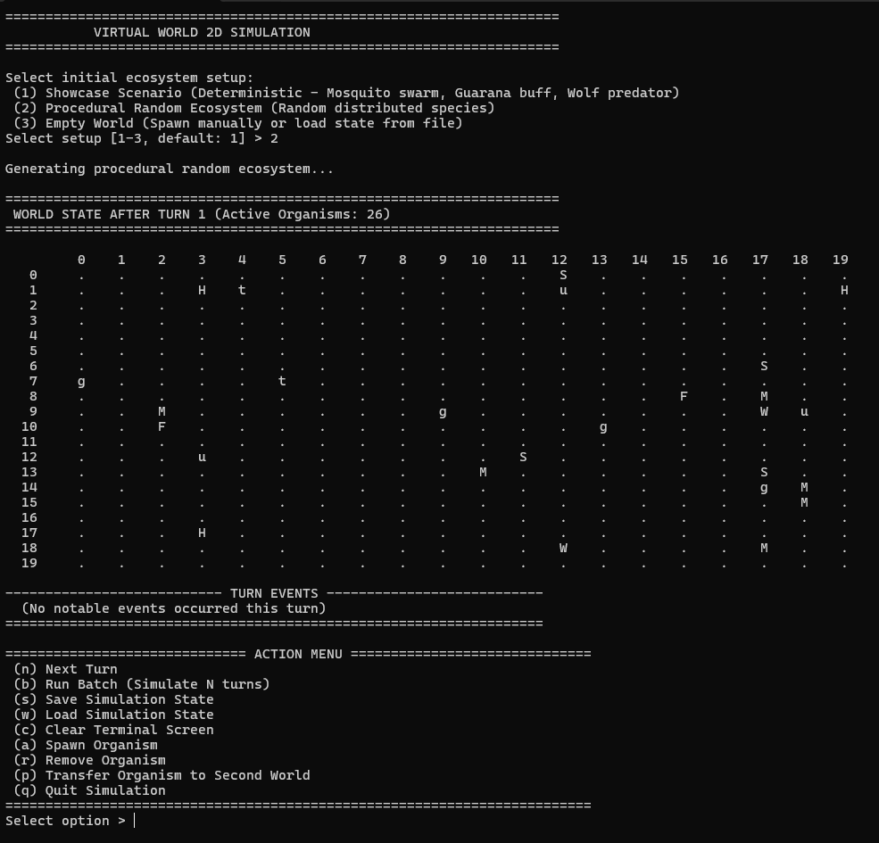
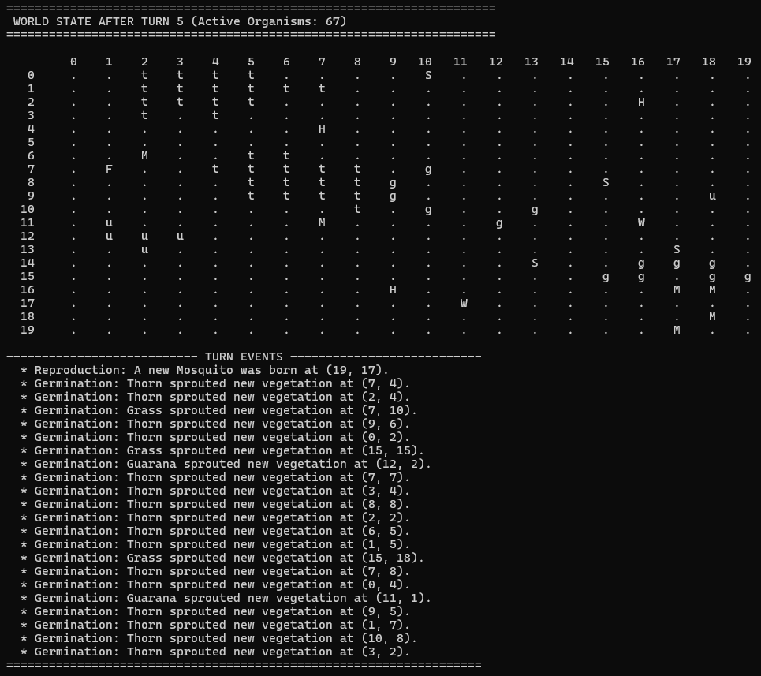

# Virtual World 2D Simulation (Modern C++20)

[](https://isocpp.org/)
[](https://cmake.org/)
[](.github/workflows/ci.yml)
[](LICENSE)

A turn-based 2D grid ecosystem simulation written in **C++20**.

This project started as a university assignment written in legacy C++ (raw owning pointers, manual memory tracking, OS-specific headers). I refactored the entire codebase to modern C++ to practice production-level patterns: **strict RAII, clear ownership semantics, clean OOP without type-switching, and standard library algorithms**.

---

## Key Highlights

- **Strict RAII & No Leaks:** All dynamic memory is managed via `std::unique_ptr`. Destructors are defaulted (`= default;`), eliminating manual `delete` calls. Verified clean under AddressSanitizer.
- **Clear Ownership Model:** `World` uniquely owns all organisms (`std::vector<std::unique_ptr<Organism>>`). The 2D grid holds non-owning raw pointers (`Organism*`) strictly for fast board lookups.
- **Polymorphic Interactions (OCP):** Removed string-based type checks (`species == "Guarana"`). Organisms interact via virtual hooks like `onAttackedBy(...)`, so new species can be added without touching combat or movement loops.
- **Safe Two-Phase Updates:** Modifications during a turn (deaths, births) are queued and resolved at the end of the turn using C++20 `std::erase_if`. This prevents iterator invalidation and dangling pointers while looping over entities.
- **Zero-Allocation Board Layout:** Uses a flat `std::array<std::array<Organism*, 20>, 20>` instead of nested vectors, eliminating 21 separate heap allocations on startup.
- **Cross-Platform & CI:** Portable standard C++20 (ANSI terminal escape sequences instead of `<conio.h>` or `system("cls")`). Automated Linux and Windows builds run on push via GitHub Actions.

---

## Refactoring Overview (Legacy vs. Modern C++)

| Area | Legacy Academic Code (Before) | Modern C++20 (After) |
|---|---|---|
| **Memory Management** | Raw `new`/`delete`, manual tracking, leaks on reset | **RAII & Single Ownership** via `std::unique_ptr`. Zero manual deletions. |
| **Grid Storage** | `std::vector<std::vector<Organism*>>` (21 separate heap allocations) | Flat `std::array<std::array<Organism*, 20>, 20>` (0 heap allocations for grid structure). |
| **Object Lifetime** | Direct deletion inside active loops (iterator invalidation & double-free risks) | **Two-phase deferred updates** using C++20 `std::erase_if` and `std::move`. |
| **Object Design** | String checks (`getSpecies() == "Wolf"`) breaking OCP | **Polymorphic dispatch** (`defender->onAttackedBy(attacker)`). Open for extension. |
| **Code Duplication** | 30-line movement and reproduction loops copied across classes | **Template Method pattern**: shared base movement parameterized by virtual getters (`getMovementRange()`). |
| **RNG** | Re-creating and re-seeding `std::mt19937` on every roll | **Thread-local PRNG utility** (`Random::getInt`) initialized once per thread. |
| **Turn Scheduling** | Unstable `std::sort` causing order flickering for equal initiative | **`std::stable_sort`** for deterministic, reproducible turns. |
| **Portability** | Windows-only `<conio.h>` and `system("cls")` | Standard ANSI escape sequences, CMake 3.20+, and GitHub Actions CI. |

---

## Console Interface


*Initial board generation and menu.*


*Turn events: combat log, seed dispersal, and status changes.*

---

## Organisms Specification

```text
                     +-------------------+
                     |     Organism      |  (Abstract Base: getSymbol(), action())
                     +-------------------+
                               |
                +--------------+--------------+
                |                             |
       +-------------------+         +-------------------+
       |      Animal       |         |       Plant       |
       +-------------------+         +-------------------+
         |   |    |    |   |           |       |       |
       Wolf Sheep Fox Hare Mosquito   Grass  Guarana  Thorn
```

| Symbol | Species | Type | Base Strength | Initiative | Trait / Behavior |
|:---:|:---|:---:|:---:|:---:|:---|
| `W` | **Wolf** | Animal | 9 | 5 | High base strength. |
| `S` | **Sheep** | Animal | 4 | 4 | Standard grazer behavior. |
| `F` | **Fox** | Animal | 3 | 7 | Cautious: avoids moving into tiles occupied by stronger organisms. |
| `H` | **Hare** | Animal | 2 | 2 | Fast runner: movement range extended to 2 tiles. |
| `M` | **Mosquito** | Animal | 1 | 1 | Swarm bonus: gains +1 strength per adjacent friendly Mosquito. |
| `g` | **Grass** | Plant | 0 | 0 | Spreads to adjacent empty tiles (50% chance). |
| `u` | **Guarana** | Plant | 0 | 0 | Grants a permanent +3 strength bonus to the animal that consumes it. |
| `t` | **Thorn** | Plant | 2 | 0 | Hazard: damages attackers with strength below 2. |

---

## Building and Running

### Requirements
- **Compiler:** GCC 10+, Clang 11+, or MSVC 2019 (16.10+) / 2022
- **Build System:** CMake 3.20+

### Build Instructions

```bash
# 1. Clone repository
git clone <repository-url>
cd virtual-world

# 2. Configure build
cmake -B build -DCMAKE_BUILD_TYPE=Release

# 3. Build executable and tests
cmake --build build --config Release

# 4. Run simulation
./build/VirtualWorld             # Linux / macOS
./build/Release/VirtualWorld.exe # Windows
```

---

## Testing

Unit tests are written with **GoogleTest** and pulled automatically during build via CMake `FetchContent`.

```bash
# Run all tests via CTest
ctest --test-dir build --output-on-failure

# Or run the binary directly
./build/VirtualWorldTests
```

### Covered Test Cases
- **Factory & Entities:** initial stats, symbols, and polymorphic construction.
- **Grid Bounds & Exceptions:** out-of-bounds checks and collision handling.
- **Combat Logic:** strength resolution, tie-breaking rules, and death flags.
- **Plant Interactions:** Guarana strength buff (+3) and Thorn counter-damage.
- **Ownership Transfer:** verifying `std::move` transfers entity ownership cleanly between collections.
- **Two-Phase Erasure:** verifying perished entities are purged via `std::erase_if` without iterator invalidation.

---

## Controls

| Key | Action | Description |
|:---:|:---|:---|
| `n` | **Next Turn** | Runs 1 simulation turn. |
| `b` | **Batch Run** | Runs N turns in sequence. |
| `s` | **Save State** | Serializes world state to file. |
| `w` | **Load State** | Restores world state from file. |
| `c` | **Clear Screen** | Redraws grid in the terminal. |
| `a` | **Add Organism** | Spawns an organism at given (Y, X). |
| `r` | **Remove Organism** | Deletes an organism at given (Y, X). |
| `q` | **Quit** | Exits simulation cleanly. |

---

## License

Distributed under the [MIT License](LICENSE).
